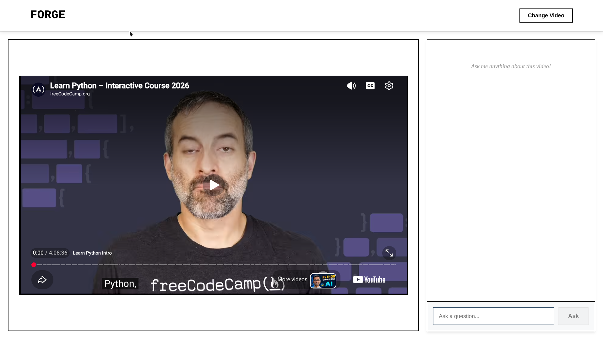

# Forge

Forge is an AI-powered YouTube video assistant that lets users load a YouTube video, view it inside the application, and ask questions about the video's transcript.

The project combines a React frontend with a FastAPI backend. YouTube transcripts are retrieved automatically and processed with Google's Gemini AI models to provide contextual answers.

## Features

- Load videos using YouTube URLs
- Display YouTube videos inside the application
- Automatically retrieve YouTube transcripts
- Ask questions about a loaded video
- Receive AI-generated answers based on the video's transcript
- Display Markdown-formatted responses
- Change the loaded video without refreshing the page
- Loading and error states for better user feedback
- Gemini model fallback support

## Tech Stack

### Frontend

- React
- Vite
- JavaScript
- CSS
- React Markdown

### Backend

- Python
- FastAPI
- Uvicorn
- YouTube Transcript API
- Google Gemini API
- Python Dotenv

## Project Structure

```text
Forge/
├── backend/
│   ├── main.py
│   ├── summary_generate.py
│   ├── requirements.txt
│   └── .env.example
│
├── frontend/
│   ├── src/
│   │   ├── components/
│   │   │   └── Video.jsx
│   │   ├── App.jsx
│   │   ├── App.css
│   │   ├── index.css
│   │   └── main.jsx
│   ├── package.json
│   └── index.html
│
└── readme_repo.md
```

## How It Works

1. The user enters a YouTube video URL.
2. The frontend sends the URL to the backend.
3. The backend extracts the YouTube video ID.
4. The YouTube transcript is retrieved using `youtube-transcript-api`.
5. The transcript is provided to Google's Gemini model.
6. The user can ask questions about the video.
7. Gemini generates answers using the loaded transcript as context.

## Requirements

Before running the project, install:

- Node.js
- npm
- Python 3.9 or later
- A Google Gemini API key

## Backend Setup

Open a terminal and move into the backend directory:

```bash
cd backend
```

Create a virtual environment:

```bash
python -m venv venv
```

Activate the virtual environment.

### Windows

```bash
venv\Scripts\activate
```

### macOS/Linux

```bash
source venv/bin/activate
```

Install the Python dependencies:

```bash
pip install -r requirements.txt
```

Create a `.env` file inside the `backend` directory:

```env
GEMINI_API_KEY=your_gemini_api_key_here
```

Start the FastAPI server:

```bash
uvicorn main:app --reload
```

The backend will run at:

```text
http://localhost:8000
```

## Frontend Setup

Open a second terminal and move into the frontend directory:

```bash
cd frontend
```

Install the frontend dependencies:

```bash
npm install
```

Start the Vite development server:

```bash
npm run dev
```

The frontend will usually be available at:

```text
http://localhost:5173
```

## Available Frontend Scripts

Run these commands from the `frontend` directory.

### Start the development server

```bash
npm run dev
```

### Build the frontend

```bash
npm run build
```

### Preview the production build

```bash
npm run preview
```

### Run ESLint

```bash
npm run lint
```

## API Endpoints

### Health Check

```http
GET /
```

Returns a basic response from the backend.

### Load a Video

```http
POST /load
```

Request body:

```json
{
  "url": "https://www.youtube.com/watch?v=VIDEO_ID"
}
```

This endpoint retrieves the transcript and initializes an AI chat session for the video.

### Ask a Question

```http
POST /qa
```

Request body:

```json
{
  "url": "https://www.youtube.com/watch?v=VIDEO_ID",
  "question": "What is this video about?"
}
```

Example response:

```json
{
  "answer": "The video explains..."
}
```

## Environment Variables

The backend requires the following environment variable:

| Variable | Description |
|---|---|
| `GEMINI_API_KEY` | API key used to access Google's Gemini models |

Never commit your actual `.env` file or API key to GitHub.

## Supported YouTube URLs

Forge supports common YouTube URL formats, including:

```text
https://www.youtube.com/watch?v=VIDEO_ID
https://youtu.be/VIDEO_ID
```

## AI Models

The backend uses a primary Gemini model and a fallback model:

- Primary model: `gemini-3-flash-preview`
- Fallback model: `gemini-2.5-flash`

If the primary model is unavailable or rate-limited, the application attempts to use the fallback model.

## Limitations

- The video must have an available transcript.
- The application currently uses an in-memory chat store.
- Chat sessions are lost when the backend restarts.
- The frontend currently uses `http://localhost:8000` as the backend URL.
- YouTube or Gemini API limitations may affect availability.
- The application does not download or permanently store videos.
- A valid Gemini API key is required for AI responses.

## Future Improvements

Possible future improvements include:

- Add video summaries
- Add conversation history
- Store chat sessions in a database
- Add user authentication
- Support more video platforms
- Add timestamps to AI answers
- Allow users to export conversations
- Add configurable backend URLs
- Add deployment instructions
- Improve transcript error handling
- Add automated tests
- Add streaming AI responses

## License

This project does not currently specify a license.